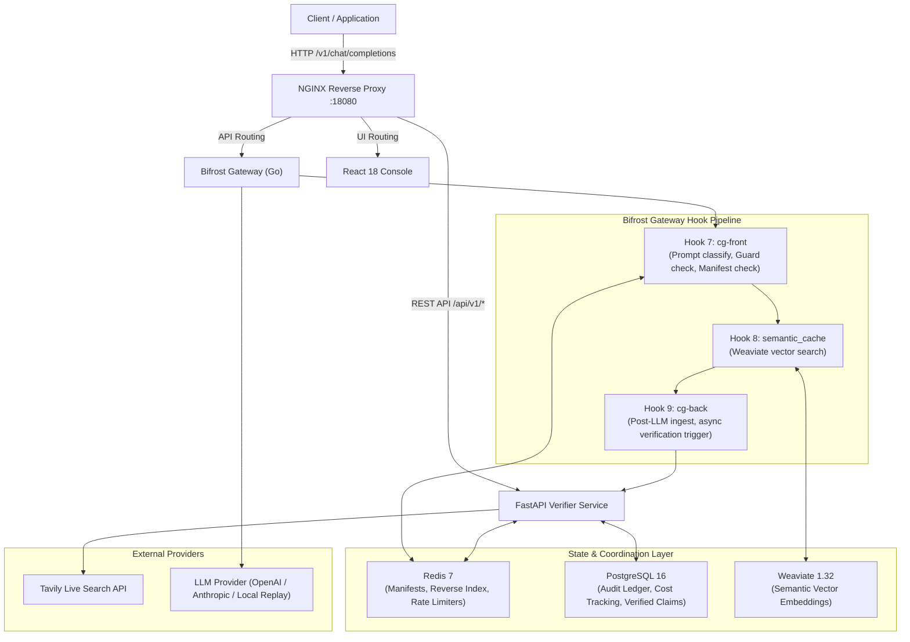

# ChronoGuard

> **Active Semantic Cache Invalidation Gateway for Large Language Models**  
> *Eliminating stale hallucinations in cached LLM responses without sacrificing speed or budget.*

[](docs/audit.md)
[](chronoguard/verifier/tests)
[](chronoguard/bifrost/plugins/chronoguard)
[](chronoguard/console)
[](LICENSE)

---

## 📌 Executive Summary

Traditional LLM semantic caches suffer from **time blindness**: when an external fact changes (such as a new software version, a policy update, or a stock price change), the cache continues to confidently serve outdated answers.

**ChronoGuard** transforms passive caching into an active truth-maintenance memory layer:
1. **Deconstructs LLM responses** into atomic factual claims `[Entity, Attribute, Stated Value]`.
2. **Maintains a shared Fact Ledger** across all semantic cache entries.
3. **Monitors live web evidence via Tavily** with domain authority weighting.
4. **Cascades invalidation instantly** across the Redis reverse index when a fact changes.
5. **Grounded re-generation** repairs stale answers on the fly before users receive them.

---

## 📊 Market Comparison & Empirical Benchmark

In our controlled 1,000-request release timeline replay comparing passive caches, static TTLs, and ChronoGuard:

| Cache Strategy | Stale Hits / 1,000 Req | Evidence Credits / 1,000 Req | Grounded Repairs |
|:---|:---:|:---:|:---:|
| **Passive Cache-Only** | 681.03 | 0.00 | 0 |
| **Fixed TTL (1 Hour)** | 10.27 | 1000.00 | 144 |
| **Fixed TTL (12 Hours)** | 5.40 | 95.89 | 12 |
| **Fixed TTL (48 Hours)** | 338.54 | 27.40 | 4 |
| **Always Verify (No Cache)** | 0.00 | 2000.00 | 4 |
| **ChronoGuard Claim Ledger** | **5.17** | **68.49** | **4** |

- **99.2% Staleness Reduction:** Slashes stale answers from 681 down to 5.17 per 1,000 hits.
- **93.1% Cost Savings:** Uses 93% fewer evidence credits than 1-hour TTLs while achieving superior freshness.

---

## 🏗️ Architecture



---

## ⚡ Key Innovations

### 1. Semantic-Hit Guard (Go Hook)
Vector caches often mistakenly match queries with distinct temporal anchors (e.g., *"Apple CEO in 2010"* vs. *"Apple CEO in 2024"*). ChronoGuard's in-gateway Go guard detects entity, number, and polarity inversions in microseconds, automatically bypassing the cache to prevent false matches.

### 2. Budget-Optimal Poisson Scheduler
Implements Cho & Garcia-Molina's Poisson change-rate estimator paired with a constrained Lagrangian solver to allocate revalidation checks to high-traffic, fast-drifting facts within strict API credit budgets.

### 3. Delta Revalidation (HTTP 304 Fast Path)
Conditional HTTP GET/HEAD probes verify whether authoritative documentation has changed without burning search credits or LLM tokens, achieving sub-15ms re-certification.

---

## 🚀 Quickstart: Run the Self-Contained Replay

The replay environment runs with zero external API dependencies using a mock LLM and Tavily fixture provider:

```bash
cd chronoguard

# 1. Bootstrap secrets and environment configuration
uv run --project verifier python scripts/bootstrap.py

# 2. Start the Docker replay stack
docker compose -f docker-compose.yml -f deploy/compose.replay.yml -p chronoguard-replay up --build -d --wait

# 3. Run the automated release proof scenario
uv run --project verifier python scripts/release_demo.py --output release-proof.json
```

Open the console at **`http://localhost:18080`** (or `http://localhost:8080` if standard port) and sign in using the password in `chronoguard/.admin-password`.

---

## 🖥️ Console Pages Overview

The React 18 console includes 10 dedicated management and observability views:
- **Freshness Overview (`/`):** Real-time freshness metrics, decision breakdown, and interactive Redis probe widget.
- **Playground (`/playground`):** Live chat through Bifrost with color-coded factual claim highlighting.
- **Live Feed (`/feed`):** Real-time Server-Sent Events (SSE) tracing request lifecycles.
- **Cache Explorer (`/cache`):** Inspect cached answers, manifests, and trigger manual revalidation/eviction.
- **Fact Ledger (`/facts`):** Reverse-index inspector showing all cache entries affected by drifting facts.
- **Costs & Latency (`/costs`):** Measured spend, token savings, and delta revalidation efficiencies.
- **ROI Analytics (`/roi`):** Quantified stale hits prevented and projected cost savings.
- **Evaluation Lab (`/eval`):** Benchmark replay suite supporting FreshQA and StaleBench datasets.
- **Policies (`/policies`):** Configurable strictness, fail-closed boundaries, and volatility classes.
- **Settings (`/settings`):** Health monitoring across all 6 underlying services and evaluation clock control.

---

## 📁 Repository Structure

```
├── .agents/                    # Agentic workflows and graphify rules
├── .github/workflows/          # CI/CD verification pipelines
├── chronoguard/                # Core ChronoGuard implementation
│   ├── bifrost/plugins/        # Go plugins (cg-front, cg-back, guard, classify)
│   ├── console/                # React 18 + Vite + TypeScript dashboard
│   ├── verifier/               # FastAPI claim extraction, judge, and scheduler
│   ├── deploy/                 # Docker Compose and NGINX configurations
│   ├── eval/                   # Benchmark datasets (FreshQA-100, StaleBench)
│   ├── scripts/                # Bootstrap, demo replay, and verification scripts
│   └── docker-compose.yml      # Base multi-service orchestration
├── docs/                       # Technical specifications, PRDs, and audit reports
├── screenshots/                # Verified desktop and mobile console captures
└── scripts/                    # Shell and PowerShell runner wrappers
```

---

## 🛡️ License

This project is licensed under the Apache 2.0 License.
