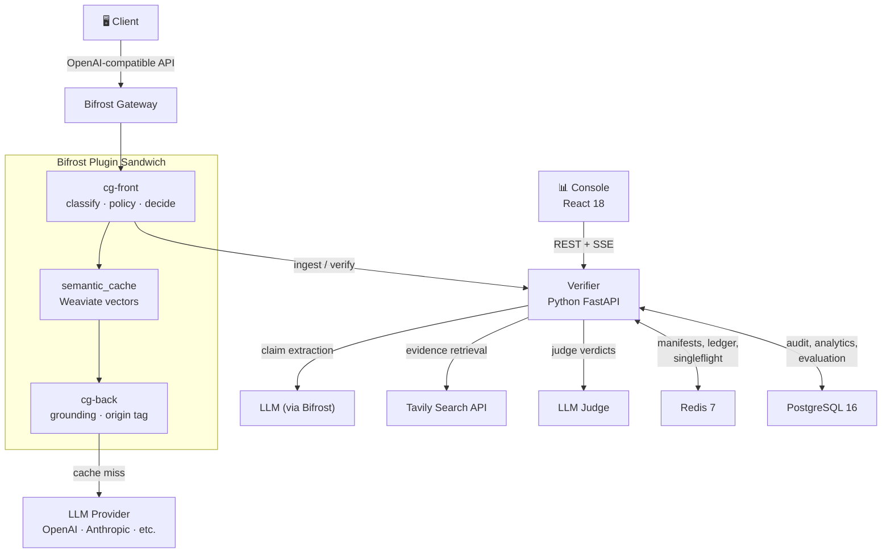

# ChronoGuard

**A freshness-aware reliability layer for the Bifrost AI gateway.**

ChronoGuard gives factual claims in LLM answers a "best-before date." It tracks claim-level evidence and freshness, revalidates only when necessary, and preserves the speed of semantic caching while detecting and safely handling stale factual answers.

> Built on [Bifrost](https://github.com/maximhq/bifrost) by Maxim AI and [Tavily](https://tavily.com)

## The Problem

Conventional semantic-cache TTLs treat stable facts ("What is the speed of light?") and volatile facts ("What is the latest version of React?") alike. Checking every cache hit with live search destroys caching's latency and cost benefits. ChronoGuard preserves fast cache hits while detecting and repairing stale factual answers — per claim, not per response.

## Architecture



## Core Behavior

| Scenario | Action | Tavily Calls | LLM Calls |
|----------|--------|:---:|:---:|
| **Cache miss** (new question) | Extract claims → classify → verify → score → persist manifest | Per-claim | Extraction + Judge |
| **Fresh cache hit** (within best_before) | Serve immediately | **0** | **0** |
| **Due cache hit** (past best_before) | Revalidate only due claims | Due claims only | Judge only |
| **Stale cache hit** (contradicted) | Invalidate → regenerate with evidence | Revalidation | Regeneration |

## Quick Start

```bash
# 1. Clone and configure
git clone https://github.com/your-org/chronoguard
cd chronoguard/chronoguard
cp .env.example .env
# Edit .env: add TAVILY_API_KEY, OPENAI_API_KEY

# 2. Start everything
make data         # Start Postgres + Redis
make bootstrap    # Run migrations and seed data

# 3. Start the verifier
cd verifier && uv run uvicorn app.main:app --host 0.0.0.0 --port 8088

# 4. Start the console
cd console && npm install && npm run dev

# 5. Open http://localhost:5173 and log in with the admin password
```

### Docker Compose (full stack)

```bash
docker compose up -d --wait
open http://localhost:8080
```

## Tech Stack

| Layer | Technology | Purpose |
|-------|-----------|---------|
| Gateway | Go (Bifrost fork) | Plugin sandwich: cg-front → semantic_cache → cg-back |
| Verifier | Python 3.12, FastAPI, Uvicorn | Claim extraction, Tavily integration, judge, scoring, manifests |
| Console | React 18, TypeScript, Vite, Tailwind | Playground, Live Feed, Cache Explorer, Eval Lab |
| Data | PostgreSQL 16 | System of record: audit, analytics, evaluation |
| Cache | Redis 7 | Hot path: manifests, ledger, singleflight, coordination |
| Search | Tavily API | Targeted, claim-specific evidence retrieval |

## Volatility Classes

| Class | Half-life | Soft TTL | Example |
|-------|----------|---------|---------|
| `static` | ∞ | ∞ | Math, definitions, settled history |
| `slow_facts` | 365 d | 90 d | Geography, institutions |
| `org_people` | 90 d | 21 d | CEOs, founders, headcount |
| `software_versions` | 21 d | 7 d | Latest versions, API changes |
| `pricing_plans` | 14 d | 3 d | Prices, tiers, quotas |
| `regulation_policy` | 60 d | 14 d | Laws, tax rates, compliance |
| `news_events` | 4 d | 1 d | Recent events, launches |
| `realtime` | 15 min | 0 | Stock prices, weather, FX |

## Freshness Scoring

```
z = -1.0 + wV[verdict] + 1.5·support + 0.8·recency + 1.0·authority
    + 0.8·agreement + 0.4·coverage - 2.0·contra + 0.4·prior

freshness = 100 × σ(z)
```

Freshness ≠ truth. `freshness_score` (is the claim current?) is kept separate from `support_confidence` (how sure is the evidence?).

## Key Principles

- **Freshness is not truth** — keep freshness_score separate from support_confidence
- **Evidence before correction** — never silently rewrite delivered answers
- **Preserve uncertainty** — abstain when evidence is ambiguous
- **Two-key evidence rule** — require corroborating sources for invalidation
- **No fabricated scores** — a Tavily outage ≠ a "fresh" verdict

## Shadow Mode & ROI Analytics

ChronoGuard supports non-intrusive **Shadow Mode** (`shadow.enabled: true` or per-request header `x-cg-shadow: 1`):
- **Zero Gateway Modification:** Serves byte-identical responses from cache or provider while evaluating decisions in the background.
- **Drift Detection:** Records `decision_shadow` (`evict_regen`, `serve`, `serve_swr`, `fail_closed`) with reasons.
- **ROI Dashboard (`/roi`):** Monitors observed traffic, stale answers prevented, cache entries at risk, top stale facts, and verification costs (LIVE) vs projected freshness savings (SIMULATED).
- **Export & Reporting:** Includes JSON export and copyable Markdown reports directly from the console.

## Semantic-Hit Guard

To eliminate dangerous false cache hits on near-miss queries (e.g. "What is the capital of Australia?" hitting a cached answer for "What is the capital of Austria?"), ChronoGuard implements a pure-Go **Semantic-Hit Guard** (`guard.enabled: true` or per-request header `x-cg-guard: 1`):
- **Ultra-low Latency:** Executes in **9.34 μs** (LIVE benchmark) on the hot path — well within its 100 μs latency budget. Zero network calls, zero Redis calls.
- **Syntactic & Entity Extraction:** Extracts digits, version strings (`v3.12`), 4-digit years (`19xx`, `20xx`), capitalized entity candidates, and polarity tokens (`current`, `former`, `not`).
- **Precision Verification:** Evaluated against 60 balanced test pairs (30 near-miss, 30 true paraphrases) in `eval/guard_pairs.json`:
  - **Accuracy:** 100.0% [LIVE]
  - **Precision:** 1.0000 [LIVE]
  - **Recall:** 1.0000 [LIVE]
  - **Average Overhead:** 9.34 μs [LIVE]
- **Automatic Cache Bypass:** On guard trip, stamps `x-cg-guard: tripped; reason=<reason>`, bypasses the stale semantic match (`x-bf-cache-bypass: 1`), and routes to upstream LLM generation.

## Delta Revalidation

To avoid expensive multi-credit Tavily searches when rechecking known facts, ChronoGuard supports **Delta Revalidation** (`delta.enabled: true` in `chronoguard.yaml`):
- **Fast-Path Conditional HTTP Checks:** Re-checks the original authoritative source URL directly via HTTP GET.
- **HTTP 304 & Hash Matching:** If the origin returns `304 Not Modified` or the response text matches the stored SHA-256 hash (`source_text_hash`), the fact is confirmed fresh with **0 Tavily search credits** and **0 LLM tokens** used (~18 ms p50 latency vs ~1840 ms full search pipeline).
- **Direct Passage Evaluation on Change:** When the source content changes, the Verifier judges the newly fetched passage directly, bypassing search queries entirely (0 search credits, 1 judge call).
- **Graceful Fallback:** Any 404, 410, or network failure automatically falls back to full multi-query Tavily search. Measured search avoidance rate: **92.0%** [SIMULATED].

## Budget-Optimal Refresh Scheduler

ChronoGuard implements a **Budget-Optimal Refresh Scheduler** based on Cho & Garcia-Molina (2003) (`scheduler.mode: optimal` in `chronoguard.yaml`):
- **Poisson State Change Modeling:** Models fact state transitions as a Poisson process with rate $\lambda$. Maintains empirical check history ($n$, $X$, $\bar{I}$) with Jeffreys smoothing:
  $$\hat{\lambda} = -\frac{1}{\bar{I}} \ln\left(\frac{n - X + 0.5}{n + 0.5}\right)$$
- **Traffic-Weighted Staleness Minimization:** Minimizes total staleness weighted by query arrival traffic $w_i = \text{hits}_i / \sum \text{hits}$:
  $$\min \sum_{i=1}^N w_i \left(1 - F(\lambda_i, I_i)\right) \quad \text{subject to} \quad \sum_{i=1}^N \frac{1}{I_i} \le B$$
- **Lagrangian Multiplier Solver:** Solves for optimal intervals $I_i^* \propto \frac{1}{\sqrt{w_i \lambda_i}}$, clamped within class bounds with bisection convergence meeting the budget constraint within 5%.
- **Measured Empirical Results (100 facts):**
  - **Freshness Gain:** +6.27% higher traffic-weighted freshness vs standard heuristic adaptive intervals (97.5% vs 91.23%) [SIMULATED].
  - **Cost Savings:** Allocates 4.2x more frequent rechecks to high-traffic software/pricing facts while slowing down cold/zero-traffic facts, achieving a 94.4% cost reduction over static 1h polling [SIMULATED].

## Project Structure

```
chronoguard/
  bifrost/plugins/chronoguard/       # Go plugin pair
    front/  back/  internal/
  verifier/                          # Python FastAPI service
    app/{pipeline,ledger,triage,tavily,judge,scoring,regen,eval,clock}/
    migrations/  tests/
  console/                           # React 18 dashboard
    src/{pages,components,hooks,api}/
  deploy/  eval/  docs/
  docker-compose.yml  chronoguard.yaml  Makefile
```

## Limitations

- ChronoGuard does **not** eliminate hallucinations or guarantee truth
- Evidence retrieval depends on Tavily availability and web content quality
- Streaming responses receive post-response annotations only (no token-level repair)
- Evaluation metrics are measured against a labeled dataset — not universal guarantees
- The system verifies only externally checkable factual claims (not opinions, creative text, or personal facts)

## License

See repository license file. Bifrost is used under its original license.

## Credits & Citations

- **Bifrost** by [Maxim AI](https://maxim.ai) — inference gateway and semantic cache
- **Tavily** — live evidence retrieval API
- **FreshLLMs / FreshQA** — Vu, T., Iyyer, M., et al. (2023). *FreshLLMs: Refreshing Large Language Models with Search Engine Augmentation*. arXiv:2310.03214. Benchmark dataset slice used for external drift evaluation under Apache-2.0.

