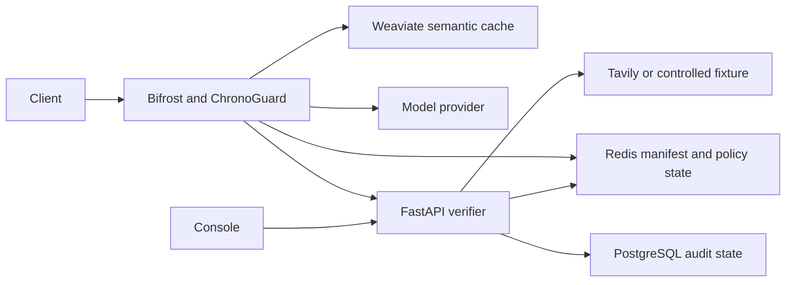

# ChronoGuard architecture

ChronoGuard owns delivery decisions for non-streamed text chat at the Bifrost gateway. The verifier owns claim and evidence state. The console is a client of those decisions.

## Cache lifecycle

Bifrost runs ChronoGuard's front hook before semantic cache lookup and after completion. The hook reads Bifrost's cache lookup outcome and matches the returned text digest to the manifest. A valid fresh hit bypasses factual verification. For a due hit, the verifier checks due claims and writes updated manifest revisions. If a known-stale answer needs regeneration, the verifier invokes the pinned gateway's exact cache deletion API and sends a cache-disabled chat request with the original conversation and evidence. It verifies the generated claims before returning replacement text to the front hook. The internal retry stays outside the cache. The next ordinary request follows the normal cache-miss flow.

Tenant-scoped reverse indexes connect a fact to all affected cache entries. A changed fact marks affected manifests stale, including entries that have yet to receive another request. A Redis watch-and-set prevents concurrent revalidation and cascade writes from silently overwriting a changed manifest. PostgreSQL keeps the audit view and revision. Evidence and prompt identity are checked before a verdict is reused.

## Decisions and tradeoffs

- **Strict** holds verification-sensitive text until a successful result. It rejects unsupported stream requests before emitting answer tokens.
- **Standard** can return eligible annotated uncertainty or serve while a due check is queued. It withholds known-stale text when replacement verification fails.
- **Shadow** observes available manifest state and records a hypothetical decision without running a mutating revalidation. An authorized operator may opt a local request into shadow mode.
- **Guard** compares typed signatures for the incoming query and cached candidate. If it rejects the candidate, the gateway waits for a cache-disabled completion for the incoming request.
- **Delta** is opt-in for administrator-approved authoritative HTTPS URLs. It binds conditional validators to a previously accepted source representation, preserves authority, and falls back to Tavily when evidence is inconclusive.
- **Refresh allocation** is an opt-in due-on-access policy. It allocates refresh rates over a bounded group of recent facts using estimated volatility, traffic and source cost. It does not run a background refresh dispatcher.

The checked-in Bifrost integration is pinned by `bifrost/upstream.lock`. Compose exposes the console and public chat endpoints on a loopback proxy. Cache administration and internal verifier routes stay on the private container network.

## Evidence and claims

Source authority and a claim-specific contradiction gate cache invalidation. Evidence that contradicts the old value still requires a positive check of the newly generated value. Claim freshness is a decision score. Verified source metadata, provider calls, and search credits support an audit. Calibration and live predictive performance require a separate measured study.

